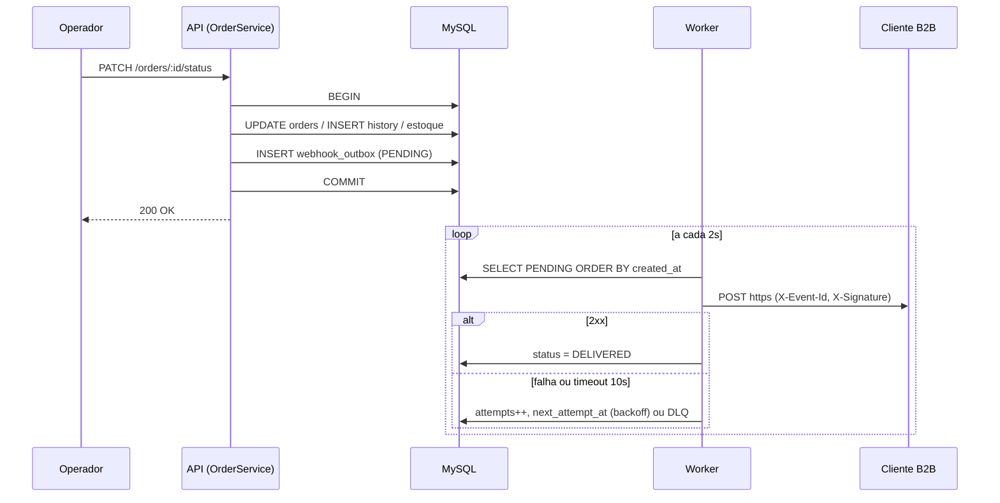
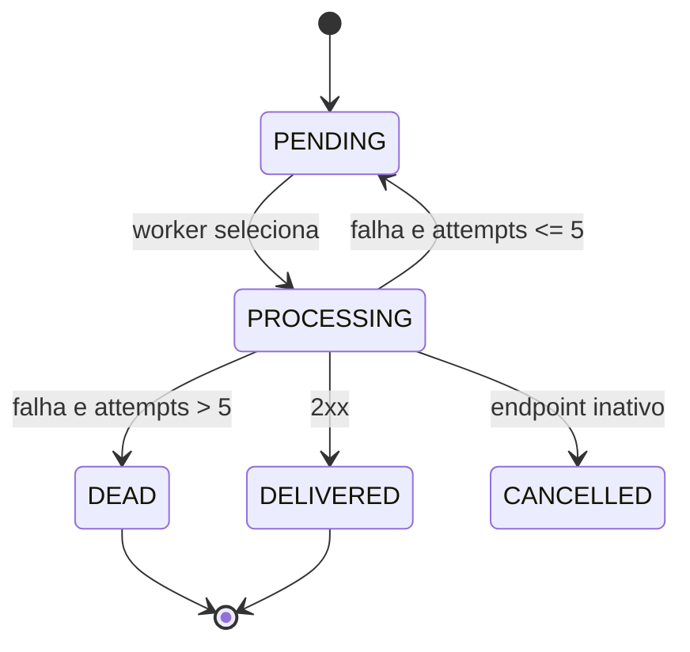

### FDD: Webhooks de Notificação de Mudança de Status de Pedidos

Versão: 1.0
Data: 2026-11-09
Responsável: Larissa (Tech Lead), com Bruno (Pedidos) e Diego (Plataforma)

> FDD (Feature Design Doc / Documento de Design da Funcionalidade). Este documento detalha **como construir** a funcionalidade. O "o que e por quê" está no [RFC](./RFC.md) e as decisões fechadas estão nos ADRs em [`docs/adrs/`](./adrs/README.md). Itens marcados com **(hipótese)** não foram decididos na reunião e precisam de validação da equipe.

---

### 1. Contexto e motivação técnica

Clientes B2B (Atlas Comercial, MaxDistribuição, Nova Cargo) fazem polling em `GET /api/v1/orders` para descobrir mudanças de status ([09:00] Marcos). A funcionalidade substitui esse polling por **webhooks HTTP de saída**, disparados a cada mudança de status de pedido, com latência abaixo de 10 segundos ([09:02] Marcos).

**Encaixe na arquitetura existente.** O sistema é um monólito modular Express 4 + Prisma 5 + MySQL 8. A mudança de status acontece em `OrderService.changeStatus` (`src/modules/orders/order.service.ts`), dentro de uma transação interativa do Prisma que atualiza `orders`, insere em `order_status_history` e debita ou repõe estoque. A funcionalidade adiciona:

- um módulo novo `src/modules/webhooks/` (CRUD de configuração, histórico de entregas, replay de DLQ);
- uma tabela outbox gravada **dentro** da transação de `changeStatus` ([ADR-001](./adrs/ADR-001-outbox-no-mysql.md));
- um processo worker separado (`src/worker.ts`) que lê a outbox e envia os webhooks ([ADR-002](./adrs/ADR-002-worker-separado-em-polling.md)).

**Atores**

| Ator | Papel |
|---|---|
| Usuário autenticado (ADMIN ou OPERATOR) | Cadastra, edita, lista e remove webhooks de um cliente; consulta entregas |
| Usuário ADMIN | Reprocessa eventos da DLQ (Dead Letter Queue / fila de mensagens mortas) |
| API (processo atual) | Grava o evento na outbox ao mudar o status |
| Worker (processo novo) | Lê a outbox, assina, envia, aplica retry e move para DLQ |
| Sistema do cliente B2B | Recebe o `POST` HTTPS, valida a assinatura e deduplica pelo `X-Event-Id` |

**Suposições**
- Os usuários que representam o cliente já existem no sistema e se autenticam com o JWT atual ([09:32] Marcos).
- O volume inicial é baixo (três clientes); um único worker é suficiente ([09:12] Diego).

**Restrições**
- Nenhuma infraestrutura nova: só MySQL ([09:07] Diego).
- Somente saída (outbound) ([09:02] Marcos).
- O worker não pode rodar no processo da API ([09:11] Diego).

---

### 2. Objetivos técnicos

- **Atomicidade:** um evento existe na outbox se e somente se a transação de mudança de status fez commit. Invariante: zero eventos órfãos e zero mudanças sem evento (para status assinados).
- **Latência:** p95 entre o commit da mudança de status e a primeira tentativa de envio menor que 10 s; esperado cerca de 2 s pelo intervalo de polling ([09:10] Larissa).
- **Entrega at-least-once (pelo menos uma vez):** todo evento é tentado até ser entregue ou ir para a DLQ após esgotar os retries ([ADR-005](./adrs/ADR-005-entrega-at-least-once-com-x-event-id.md)).
- **Idempotência no cliente:** o `X-Event-Id` de um evento é o mesmo em todas as tentativas e no replay.
- **Autenticidade:** 100% das requisições assinadas com HMAC-SHA256 com a secret do endpoint ([ADR-004](./adrs/ADR-004-hmac-sha256-com-secret-por-endpoint.md)).
- **Ordem:** com um único worker, eventos de um mesmo `order_id` são enviados na ordem de `created_at` ([09:12] Diego).
- **Isolamento:** a latência ou indisponibilidade do cliente não altera o tempo de `PATCH /orders/:id/status` além do custo de um `INSERT`.

---

### 3. Escopo e exclusões

**Incluído**
- Tabelas `webhook_endpoints`, `webhook_outbox`, `webhook_deliveries`, `webhook_dead_letter`.
- Função `publishWebhookEvent(tx, order, fromStatus, toStatus)` chamada dentro de `changeStatus`.
- Filtro por status assinado na inserção da outbox ([09:34] Bruno).
- Worker com polling de 2 s, timeout HTTP de 10 s, retry com backoff 1m/5m/30m/2h/12h e DLQ ([ADR-003](./adrs/ADR-003-retry-com-backoff-e-dlq.md)).
- Assinatura HMAC-SHA256, secret por endpoint, rotação com grace period de 24 h.
- Endpoints: CRUD de webhooks, rotação de secret, histórico de entregas, replay de DLQ (ADMIN).
- Validação: URL obrigatoriamente `https` ([09:23] Sofia), payload até 64 KB ([09:24] Larissa).
- Códigos de erro com prefixo `WEBHOOK_` ([09:29] Larissa).

**Excluído**
- Alertas por e-mail ao cliente em caso de falhas ([09:37] Larissa).
- Dashboard visual ([09:40] Larissa).
- Rate limiting de envio por cliente: "observar e decidir depois" ([09:39] Larissa).
- Múltiplos workers e ordenação global ([09:13] Larissa).
- Arquivamento de eventos entregues após cerca de 30 dias ([09:08] Diego).
- Webhooks de entrada (inbound).

---

### 4. Fluxos detalhados e diagramas

**Fluxo principal**

**F1. Criação do evento na outbox** (processo da API)
1. `PATCH /api/v1/orders/:id/status` chega em `OrderController.changeStatus`.
2. `OrderService.changeStatus` abre `prisma.$transaction(async (tx) => ...)` (comportamento atual).
3. Valida a transição (`canTransition`), debita ou repõe estoque, atualiza `orders`, insere `order_status_history` (comportamento atual).
4. **Novo:** chama `publishWebhookEvent(tx, order, from, to)`:
   1. busca em `webhook_endpoints` os registros com `customer_id = order.customerId`, `active = true` e `to` contido em `events`;
   2. se não houver nenhum, retorna sem inserir ([09:34] Bruno);
   3. para cada endpoint encontrado, renderiza o payload (snapshot, [09:52] Larissa), gera `event_id` (UUID), verifica tamanho até 64 KB e insere uma linha em `webhook_outbox` com `status = PENDING`, `attempts = 0`, `next_attempt_at = now()`.
5. Commit. Se qualquer `INSERT` na outbox falhar, a transação inteira sofre rollback e o status não muda ([09:40] Bruno).

**F2. Processamento pelo worker** (processo `src/worker.ts`)
1. A cada `WEBHOOK_POLL_INTERVAL_MS` (default 2000), o worker executa um ciclo.
2. Seleciona até `WEBHOOK_BATCH_SIZE` linhas com `status = PENDING` e `next_attempt_at <= now()`, ordenadas por `created_at` **(hipótese: lote de 20)**.
3. Marca cada linha como `PROCESSING` com `locked_at = now()`.
4. Para cada evento, em ordem:
   1. carrega o endpoint; se `active = false` ou removido, marca o evento como `CANCELLED` e segue **(hipótese)**;
   2. monta o corpo JSON a partir do snapshot e calcula `X-Signature`;
   3. envia `POST` para `url` com timeout de 10 s ([09:42] Diego);
   4. grava uma linha em `webhook_deliveries` (status HTTP, duração, corpo de resposta truncado, erro);
   5. resposta `2xx`: marca `DELIVERED` e `delivered_at`;
   6. qualquer outra resposta, timeout ou erro de rede: segue para F3.

**F3. Retry com backoff**
1. Incrementa `attempts`.
2. Se `attempts <= 5`: volta para `PENDING` com `next_attempt_at = now() + backoff[attempts]`, onde `backoff = [1m, 5m, 30m, 2h, 12h]` ([09:17] Larissa).
3. Se `attempts > 5`: segue para F4.

Com isso o evento recebe **1 envio inicial + 5 retries**, totalizando cerca de 14h36m entre a primeira falha e a última tentativa ("quase 15 horas", [09:17] Diego).

**F4. Movimentação para a DLQ**
1. Insere em `webhook_dead_letter` o `event_id`, `webhook_id`, payload, motivo da última falha, número de tentativas e `failed_at` ([09:18] Diego).
2. Marca o evento da outbox como `DEAD` (deixa de ser lido pelo worker).
3. Emite log `warn` e incrementa a métrica de DLQ.

**F5. Replay manual da DLQ** (ADMIN)
1. `POST /api/v1/admin/webhooks/dead-letter/:id/replay` com usuário de papel ADMIN.
2. Insere um novo registro em `webhook_outbox` com o **mesmo `event_id` e payload**, `status = PENDING`, `attempts = 0`.
3. Marca a linha da DLQ com `replayed_at` e `replayed_by`.
4. Registra log de auditoria com o id do usuário ([09:36] Sofia).

**Fluxos alternativos e exceções**
- **Nenhum webhook assina o status:** nenhuma linha é criada; a mudança de status segue normal.
- **Payload maior que 64 KB:** o evento não é enviado; erro `WEBHOOK_PAYLOAD_TOO_LARGE` registrado em log e o evento vai direto para a DLQ **(hipótese: não abortar a mudança de status por isso)**.
- **Worker caiu durante o envio:** linhas em `PROCESSING` com `locked_at` mais antigo que 60 s voltam para `PENDING` no início do próximo ciclo **(hipótese)**. O cliente pode receber duplicata, coberta pelo `X-Event-Id`.
- **Rotação de secret em curso:** durante as 24 h de grace period, a requisição leva as duas assinaturas (ver seção 5).
- **Ordem sob retry:** se um evento de um pedido entra em retry, eventos posteriores do mesmo pedido podem ultrapassá-lo. Limitação conhecida, aceita para esta versão **(hipótese: confirmar com Diego)**.

**Diagramas**

Sequência F1 e F2:



Estados do evento na outbox:



---

### 5. Contratos públicos (assinaturas, endpoints, headers, exemplos)

Todos os endpoints ficam sob `/api/v1`, exigem `Authorization: Bearer <JWT>` e usam o envelope de erro existente `{ "error": { "code", "message", "details" } }`. O `customer_id` vai no corpo na criação e como query string na listagem **(hipótese: a reunião deixou "no body ou no path" em aberto, [09:32] Larissa; ver RFC-QA-06)**.

**[Contrato 1] Criar webhook**
- Tipo: endpoint
- Assinatura/Rota: `POST /api/v1/webhooks`
- Método: POST
- Semântica de status/headers:
  - `201`: criado; a `secret` é retornada **somente nesta resposta** ([09:31] Marcos)
  - `400 VALIDATION_ERROR`: corpo inválido
  - `400 WEBHOOK_INVALID_URL`: URL não é `https`
  - `400 WEBHOOK_INVALID_EVENTS`: lista vazia ou status inexistente
  - `401 UNAUTHORIZED`: sem token
  - `404 WEBHOOK_CUSTOMER_NOT_FOUND`: cliente não existe

**Exemplo de requisição**
```json
{
  "customerId": "3f6c1a2e-8b1d-4c3e-9a77-0b2f5d9e1c11",
  "url": "https://api.atlascomercial.com.br/hooks/orders",
  "events": ["SHIPPED", "DELIVERED"]
}
```

**Exemplo de resposta**
```json
{
  "id": "a1b2c3d4-0000-4e5f-8a9b-112233445566",
  "customerId": "3f6c1a2e-8b1d-4c3e-9a77-0b2f5d9e1c11",
  "url": "https://api.atlascomercial.com.br/hooks/orders",
  "events": ["SHIPPED", "DELIVERED"],
  "active": true,
  "secret": "whsec_9f8e7d6c5b4a39281706f5e4d3c2b1a0",
  "createdAt": "2026-11-09T14:00:00.000Z"
}
```

**[Contrato 2] Listar webhooks de um cliente**
- Tipo: endpoint
- Assinatura/Rota: `GET /api/v1/webhooks?customerId={uuid}&page=1&pageSize=20`
- Método: GET
- Semântica de status/headers:
  - `200`: lista paginada no formato `{ data, pagination }` já usado no projeto; a `secret` **nunca** é retornada
  - `400 VALIDATION_ERROR`: `customerId` ausente ou inválido
  - `401 UNAUTHORIZED`

**Exemplo de requisição**
```json
{}
```

**Exemplo de resposta**
```json
{
  "data": [
    {
      "id": "a1b2c3d4-0000-4e5f-8a9b-112233445566",
      "customerId": "3f6c1a2e-8b1d-4c3e-9a77-0b2f5d9e1c11",
      "url": "https://api.atlascomercial.com.br/hooks/orders",
      "events": ["SHIPPED", "DELIVERED"],
      "active": true,
      "createdAt": "2026-11-09T14:00:00.000Z",
      "updatedAt": "2026-11-09T14:00:00.000Z"
    }
  ],
  "pagination": { "page": 1, "pageSize": 20, "total": 1, "totalPages": 1 }
}
```

**[Contrato 3] Editar webhook**
- Tipo: endpoint
- Assinatura/Rota: `PATCH /api/v1/webhooks/:id`
- Método: PATCH
- Semântica de status/headers:
  - `200`: atualizado (campos parciais: `url`, `events`, `active`)
  - `400 WEBHOOK_INVALID_URL` / `400 WEBHOOK_INVALID_EVENTS`
  - `404 WEBHOOK_NOT_FOUND`

**Exemplo de requisição**
```json
{ "events": ["PAID", "SHIPPED", "DELIVERED"], "active": true }
```

**Exemplo de resposta**
```json
{
  "id": "a1b2c3d4-0000-4e5f-8a9b-112233445566",
  "url": "https://api.atlascomercial.com.br/hooks/orders",
  "events": ["PAID", "SHIPPED", "DELIVERED"],
  "active": true,
  "updatedAt": "2026-11-09T15:10:00.000Z"
}
```

**[Contrato 4] Remover webhook**
- Tipo: endpoint
- Assinatura/Rota: `DELETE /api/v1/webhooks/:id`
- Método: DELETE
- Semântica de status/headers:
  - `204`: removido; eventos `PENDING` desse webhook passam a `CANCELLED` no próximo ciclo do worker **(hipótese)**
  - `404 WEBHOOK_NOT_FOUND`

**Exemplo de requisição**
```json
{}
```

**Exemplo de resposta**
```json
{}
```

**[Contrato 5] Rotacionar secret**
- Tipo: endpoint
- Assinatura/Rota: `POST /api/v1/webhooks/:id/rotate-secret` **(hipótese de rota; a decisão de existir o endpoint é de [09:21] Sofia)**
- Método: POST
- Semântica de status/headers:
  - `200`: nova secret retornada uma única vez; a anterior permanece válida até `previousSecretExpiresAt` (agora + 24 h)
  - `404 WEBHOOK_NOT_FOUND`
  - `409 WEBHOOK_ROTATION_IN_PROGRESS`: já existe uma secret anterior em grace period **(hipótese)**

**Exemplo de requisição**
```json
{}
```

**Exemplo de resposta**
```json
{
  "id": "a1b2c3d4-0000-4e5f-8a9b-112233445566",
  "secret": "whsec_0a1b2c3d4e5f60718293a4b5c6d7e8f9",
  "previousSecretExpiresAt": "2026-11-10T15:30:00.000Z"
}
```

**[Contrato 6] Histórico de entregas**
- Tipo: endpoint
- Assinatura/Rota: `GET /api/v1/webhooks/:id/deliveries?limit=100` ([09:34] Marcos)
- Método: GET
- Semântica de status/headers:
  - `200`: últimas entregas (default e máximo 100), mais recentes primeiro
  - `404 WEBHOOK_NOT_FOUND`

**Exemplo de requisição**
```json
{}
```

**Exemplo de resposta**
```json
{
  "data": [
    {
      "id": "d9e8f7a6-1111-4b2c-9d3e-445566778899",
      "eventId": "7c9e6679-7425-40de-944b-e07fc1f90ae7",
      "attempt": 2,
      "success": false,
      "httpStatus": 503,
      "durationMs": 812,
      "error": null,
      "requestPayload": { "event_type": "order.status_changed", "order_number": "ORD-000123" },
      "responseBody": "Service Unavailable",
      "createdAt": "2026-11-09T15:31:02.000Z"
    }
  ]
}
```

**[Contrato 7] Replay de evento da DLQ**
- Tipo: endpoint
- Assinatura/Rota: `POST /api/v1/admin/webhooks/dead-letter/:id/replay` ([09:18] Diego)
- Método: POST
- Semântica de status/headers:
  - `202`: evento recolocado na outbox como `PENDING`, com o mesmo `event_id`
  - `403 FORBIDDEN`: usuário não é ADMIN ([09:36] Sofia)
  - `404 WEBHOOK_DEAD_LETTER_NOT_FOUND`
  - `409 WEBHOOK_ALREADY_REPLAYED`: o item já foi reprocessado e o novo envio ainda está pendente **(hipótese)**

**Exemplo de requisição**
```json
{}
```

**Exemplo de resposta**
```json
{
  "deadLetterId": "e1f2a3b4-2222-4c5d-8e9f-001122334455",
  "eventId": "7c9e6679-7425-40de-944b-e07fc1f90ae7",
  "outboxId": "f0e1d2c3-3333-4a5b-9c8d-667788990011",
  "status": "PENDING",
  "replayedBy": "6a7b8c9d-4444-4e5f-8a9b-aabbccddeeff",
  "replayedAt": "2026-11-09T16:00:00.000Z"
}
```

**[Contrato 8] Webhook enviado ao cliente (outbound)**
- Tipo: endpoint (do cliente, chamado pelo worker)
- Assinatura/Rota: URL cadastrada pelo cliente (somente `https`)
- Método: POST
- Semântica de status/headers ([09:44] Diego, [09:44] Sofia):
  - `Content-Type: application/json`
  - `X-Event-Id`: UUID do evento; igual em todas as tentativas e no replay; chave de deduplicação
  - `X-Webhook-Id`: id do cadastro que originou o envio
  - `X-Timestamp`: momento do envio, ISO 8601; permite ao cliente rejeitar replays antigos
  - `X-Signature`: `sha256=<hex>` com HMAC-SHA256 do corpo bruto usando a secret do endpoint **(hipótese de formato)**; durante o grace period de rotação, duas assinaturas separadas por vírgula, a nova primeiro **(hipótese)**
  - Resposta `2xx` em até 10 s: entregue. Qualquer outra resposta ou timeout: falha, entra no retry
  - Limite: corpo até 64 KB

**Exemplo de requisição**
```json
{
  "event_id": "7c9e6679-7425-40de-944b-e07fc1f90ae7",
  "event_type": "order.status_changed",
  "timestamp": "2026-11-09T15:30:00.000Z",
  "order_id": "b5c6d7e8-5555-4f6a-8b9c-0d1e2f3a4b5c",
  "order_number": "ORD-000123",
  "customer_id": "3f6c1a2e-8b1d-4c3e-9a77-0b2f5d9e1c11",
  "from_status": "PROCESSING",
  "to_status": "SHIPPED",
  "total_cents": 125990
}
```

**Exemplo de resposta**
```json
{ "received": true }
```

**[Contrato 9] Função interna de publicação**
- Tipo: function
- Assinatura/Rota: `publishWebhookEvent(tx: Prisma.TransactionClient, order: Order, fromStatus: OrderStatus, toStatus: OrderStatus): Promise<void>` ([09:41] Bruno)
- Método: n/a
- Semântica: deve ser chamada dentro da transação de `changeStatus`; lança exceção em falha de escrita, causando rollback; não faz I/O de rede.

**Exemplo de requisição**
```json
{ "orderId": "b5c6d7e8-5555-4f6a-8b9c-0d1e2f3a4b5c", "fromStatus": "PROCESSING", "toStatus": "SHIPPED" }
```

**Exemplo de resposta**
```json
{}
```

**Parâmetros configuráveis** (novas variáveis em `src/config/env.ts`, **hipótese de nomes**)

| Variável | Default | Origem do valor |
|---|---|---|
| `WEBHOOK_POLL_INTERVAL_MS` | 2000 | [09:09] Diego |
| `WEBHOOK_HTTP_TIMEOUT_MS` | 10000 | [09:42] Diego |
| `WEBHOOK_MAX_RETRIES` | 5 | [09:17] Larissa |
| `WEBHOOK_BACKOFF_SCHEDULE` | `1m,5m,30m,2h,12h` | [09:17] Diego |
| `WEBHOOK_MAX_PAYLOAD_BYTES` | 65536 | [09:24] Diego |
| `WEBHOOK_SECRET_GRACE_HOURS` | 24 | [09:21] Sofia |
| `WEBHOOK_BATCH_SIZE` | 20 | (hipótese) |

---

### 6. Erros, exceções e fallback

- Matriz de erros previstos e tratamentos

Todos os erros de API são subclasses de `AppError` (`src/shared/errors/app-error.ts`) e passam pelo `errorMiddleware` sem alteração. Os três primeiros códigos foram citados na reunião ([09:28] Bruno); os demais seguem o mesmo padrão **(hipótese)**.

| Código | HTTP | Condição | Tratamento |
| --- | --- | --- | --- |
| `WEBHOOK_NOT_FOUND` | 404 | Webhook inexistente ou removido | Retorna erro; nada é alterado |
| `WEBHOOK_INVALID_URL` | 400 | URL não é `https` ou é malformada | Rejeita na validação Zod ([09:23] Sofia) |
| `WEBHOOK_SECRET_REQUIRED` | 500 | Endpoint sem secret ativa no momento de assinar (estado inconsistente) | Worker não envia; evento vai para retry e log `error` |
| `WEBHOOK_INVALID_EVENTS` | 400 | `events` vazio ou com status fora de `OrderStatus` | Rejeita na validação Zod |
| `WEBHOOK_CUSTOMER_NOT_FOUND` | 404 | `customerId` inexistente no cadastro | Retorna erro |
| `WEBHOOK_PAYLOAD_TOO_LARGE` | 413 | Payload renderizado maior que 64 KB | Não envia; evento direto para DLQ com esse motivo ([09:24] Larissa) |
| `WEBHOOK_ROTATION_IN_PROGRESS` | 409 | Nova rotação durante o grace period | Retorna erro; cliente aguarda o fim do período |
| `WEBHOOK_DEAD_LETTER_NOT_FOUND` | 404 | Item da DLQ inexistente | Retorna erro |
| `WEBHOOK_ALREADY_REPLAYED` | 409 | Replay de item já reprocessado e ainda pendente | Retorna erro |
| `WEBHOOK_DELIVERY_TIMEOUT` | n/a (interno) | Cliente não respondeu em 10 s | Registra em `webhook_deliveries`; aplica backoff |
| `WEBHOOK_DELIVERY_FAILED` | n/a (interno) | Resposta não `2xx` ou erro de rede/TLS | Registra em `webhook_deliveries`; aplica backoff |
| `WEBHOOK_RETRIES_EXHAUSTED` | n/a (interno) | Falhou após 1 envio + 5 retries | Move para `webhook_dead_letter` |
| `WEBHOOK_OUTBOX_WRITE_FAILED` | 500 | Falha ao inserir na outbox dentro de `changeStatus` | Rollback da mudança de status; resposta 500 ([09:40] Bruno) |

- Estratégias de resiliência:
  - **Timeout:** 10 s por requisição HTTP, via `AbortSignal.timeout` no `fetch` nativo do Node 20 **(hipótese de implementação)**.
  - **Retries:** 5, após o envio inicial.
  - **Backoff:** exponencial fixo 1m, 5m, 30m, 2h, 12h, calculado em `next_attempt_at` (sem `setTimeout` em memória, para sobreviver a reinícios do worker).
  - **Circuit breaker:** não adotado nesta versão; o backoff por evento já reduz a pressão sobre clientes indisponíveis **(hipótese)**.
- Política de fallback:
  - Esgotados os retries, o evento vai para a DLQ e só volta por replay manual de um ADMIN ([ADR-003](./adrs/ADR-003-retry-com-backoff-e-dlq.md)).
  - Falha na outbox nunca é "engolida": prevalece a consistência e a mudança de status é revertida.
  - Se o worker estiver parado, os eventos acumulam como `PENDING` sem perda e são enviados quando ele volta.
- Invariantes:
  - Status confirmado e assinado implica linha na outbox; rollback implica nenhuma linha.
  - `event_id` nunca muda entre tentativas nem no replay.
  - Um evento está em exatamente um estado: `PENDING`, `PROCESSING`, `DELIVERED`, `DEAD` ou `CANCELLED`.
  - Nenhuma requisição sai sem `X-Signature` nem para URL `http`.
  - A secret nunca aparece em logs nem em respostas, exceto na criação e na rotação.

---

### 7. Observabilidade

O projeto já tem logs estruturados com Pino, mas não tem biblioteca de métricas nem de tracing. A instrumentação de métricas e tracing abaixo é **(hipótese)**: propõe-se `prom-client` para métricas e OpenTelemetry para tracing, a validar com Diego (Plataforma).

**Métricas**
- `webhook_events_enqueued_total{event_type}`: eventos inseridos na outbox.
- `webhook_deliveries_total{result="success|failure|timeout", http_status_class}`: tentativas de envio.
- `webhook_delivery_duration_seconds` (histograma): tempo de resposta do cliente.
- `webhook_outbox_pending` (gauge): eventos `PENDING`.
- `webhook_outbox_oldest_pending_age_seconds` (gauge): idade do evento pendente mais antigo; principal sinal de worker parado ou lento.
- `webhook_end_to_end_latency_seconds` (histograma): do `created_at` do evento ao primeiro envio; valida o objetivo de menos de 10 s.
- `webhook_dead_letter_total` e `webhook_replays_total`.
- Cardinalidade: **não** usar `webhook_id`, `customer_id` nem `order_id` como label; esses dados vão para logs.

**Logs**
- Formato: JSON via logger Pino existente (`src/shared/logger/index.ts`), com `module: "webhooks"`.
- Campos essenciais: `event_id`, `webhook_id`, `customer_id`, `order_id`, `attempt`, `http_status`, `duration_ms`, `result`, `next_attempt_at`, `error_code`.
- Eventos de log: `webhook.enqueued` (info), `webhook.delivered` (info), `webhook.delivery_failed` (warn), `webhook.dead_lettered` (warn), `webhook.replayed` (info, com `user_id` para auditoria, [09:36] Sofia), `webhook.worker_cycle` (debug).
- Proteção de dados: nunca logar `secret`, `X-Signature` nem o payload completo; corpo de resposta do cliente truncado em 1 KB **(hipótese)**.

**Tracing**
- Spans principais:
  - `orders.changeStatus` com filho `webhooks.publish` (na API);
  - `webhooks.worker.cycle` com filhos `webhooks.deliver` (um por evento) e `http.client.post`.
- Atributos: `event_id`, `webhook_id`, `attempt`, `http.status_code`.
- Correlação: o `trace_id` da mudança de status é gravado na outbox para ligar o envio à requisição de origem **(hipótese)**.
- Amostragem: 100% dos spans de falha e 10% dos de sucesso **(hipótese)**.

**Dashboards e alertas**
- Painel "Webhooks": taxa de sucesso, latência p95 fim a fim, pendentes, idade do mais antigo, entradas na DLQ por dia.
- Alerta crítico: `webhook_outbox_oldest_pending_age_seconds > 60` por 5 min (worker parado).
- Alerta de atenção: taxa de falha acima de 20% em 15 min, ou qualquer entrada na DLQ.
- Alerta de SLO: p95 de `webhook_end_to_end_latency_seconds` acima de 10 s por 15 min.

---

### 8. Dependências e compatibilidade

| Componente | Versão mínima | Observações |
| --- | --- | --- |
| Node.js | 20 | Já exigido em `package.json`; fornece `fetch` e `AbortSignal.timeout` nativos |
| MySQL | 8.0 | Já em uso; suporta `SELECT ... FOR UPDATE SKIP LOCKED` caso se adote mais de um worker no futuro |
| Prisma (`prisma`, `@prisma/client`) | 5.22.0 | Já em uso; transações interativas e nova migração |
| Express | 4.21.1 | Já em uso |
| Zod | 3.23.8 | Já em uso; schemas de entrada do módulo |
| Pino | 9.5.0 | Já em uso; logs |
| `node:crypto` | nativo | HMAC-SHA256 e geração de secret; sem dependência nova |
| `prom-client` / OpenTelemetry | a definir | Novas dependências **(hipótese)**, apenas para métricas e tracing |

**Garantias de compatibilidade**
- `PATCH /api/v1/orders/:id/status` mantém contrato, status codes e corpo de resposta; muda apenas o efeito colateral interno (linha na outbox).
- Nenhuma tabela existente é alterada; a migração só cria tabelas novas.
- O contrato de saída (headers e payload) é versionado pelo campo `event_type`; mudanças incompatíveis exigirão novo `event_type` ou versão **(hipótese; versionamento ainda não decidido, ver ADR-005)**.
- Campos novos podem ser adicionados ao payload sem aviso; clientes devem ignorar campos desconhecidos (a documentar no portal, [09:26] Marcos).

---

### 9. Critérios de aceite técnicos

- **Atomicidade:** teste de integração força erro no `INSERT` da outbox e verifica que `orders.status` e `order_status_history` não mudaram.
- **Filtro:** mudança para um status não assinado não cria linha na outbox.
- **Snapshot:** alterar o pedido após a mudança de status não altera o payload enviado.
- **Entrega:** com cliente respondendo `200`, evento passa a `DELIVERED` e há uma linha de sucesso em `webhook_deliveries`.
- **Latência:** p95 entre commit e primeira tentativa menor que 10 s em ambiente de homologação (esperado cerca de 2 s).
- **Timeout:** cliente que demora 11 s gera `WEBHOOK_DELIVERY_TIMEOUT` e reagendamento para +1 min.
- **Backoff:** `next_attempt_at` segue exatamente 1m, 5m, 30m, 2h, 12h (teste com relógio controlado).
- **DLQ:** após 1 envio + 5 retries com falha, existe linha em `webhook_dead_letter` e o evento está `DEAD`.
- **Replay:** ADMIN recebe `202` e o novo envio tem o mesmo `X-Event-Id`; OPERATOR recebe `403`.
- **Assinatura:** o cliente de teste valida `X-Signature` com a secret retornada na criação; após rotação, ambas as secrets validam por 24 h e só a nova depois disso.
- **Validação:** URL `http://` retorna `400 WEBHOOK_INVALID_URL`; payload acima de 64 KB não é enviado.
- **Segredo:** `GET /webhooks` e logs nunca expõem a `secret` (teste de busca nos logs).
- **Ordem:** três mudanças rápidas PAID, PROCESSING, SHIPPED do mesmo pedido chegam nessa ordem com um único worker.
- **Observabilidade:** métricas da seção 7 expostas, logs com `event_id` em toda tentativa, spans visíveis para um envio.
- **Regressão:** a suíte existente (`tests/orders.test.ts`) continua passando.

---

### 10. Riscos e mitigação

### Esquecer a publicação na outbox em um novo fluxo de mudança de status

- **Probabilidade:** média
- **Impacto:** alto; eventos se perdem sem nenhum erro visível
- **Mitigação:**
    - concentrar a publicação em `publishWebhookEvent`, chamada só a partir de `changeStatus`
    - teste de integração que cobre commit e rollback
    - item no checklist de revisão de código do módulo de pedidos
- **Plano de contingência:** script de reconciliação que compara `order_status_history` com `webhook_outbox` e reenfileira o que faltar **(hipótese)**

### Worker único parado ou travado

- **Probabilidade:** média
- **Impacto:** alto; todas as entregas param
- **Mitigação:**
    - reinício automático pelo supervisor de processos
    - alerta de idade do evento pendente mais antigo maior que 60 s
    - recuperação de linhas presas em `PROCESSING`
- **Plano de contingência:** subir o worker manualmente; os eventos acumulados são enviados em ordem, sem perda

### Crescimento da outbox e carga de polling no MySQL principal

- **Probabilidade:** média
- **Impacto:** médio; degradação de consultas e de `changeStatus`
- **Mitigação:**
    - índices em `(status, next_attempt_at)` e `created_at`
    - lotes pequenos por ciclo
    - definir a política de arquivamento de cerca de 30 dias (RFC-QA-04)
- **Plano de contingência:** aumentar o intervalo de polling temporariamente e limpar manualmente eventos `DELIVERED` antigos

### Vazamento ou exposição de secrets

- **Probabilidade:** baixa
- **Impacto:** alto; terceiros podem forjar webhooks para um cliente
- **Mitigação:**
    - secret por endpoint, retornada só na criação e na rotação
    - nunca logar secret nem assinatura
    - armazenamento criptografado em repouso **(hipótese, decidir com Sofia)**
    - revisão de segurança de 2 dias úteis antes do deploy ([09:46] Sofia)
- **Plano de contingência:** rotação imediata da secret afetada e aviso ao cliente

### Cliente não deduplica e processa o mesmo evento duas vezes

- **Probabilidade:** média
- **Impacto:** médio; efeitos duplicados no sistema do cliente
- **Mitigação:**
    - `X-Event-Id` estável em retry e replay
    - documentação em destaque no portal do desenvolvedor ([09:26] Marcos)
- **Plano de contingência:** suporte orienta o cliente a deduplicar por `X-Event-Id` usando o histórico de entregas

### Prazo de três sprints contra a data pedida pela Atlas

- **Probabilidade:** média
- **Impacto:** alto; risco comercial de perda do cliente ([09:00] Marcos)
- **Mitigação:**
    - entregar por fatias: outbox e worker, depois retry e DLQ, depois CRUD e entregas ([09:46] Larissa)
    - reservar a revisão de segurança no fim do plano
- **Plano de contingência:** liberar primeiro para a Atlas com o fluxo principal e a DLQ, e o replay e a rotação logo em seguida

---

### 11. Integração com o sistema existente

| Arquivo | Como será integrado |
| --- | --- |
| `src/modules/orders/order.service.ts` | O método `changeStatus` (linha 126) passa a chamar `publishWebhookEvent(tx, order, from, to)` dentro do `this.prisma.$transaction(async (tx) => ...)`, logo após o `tx.orderStatusHistory.create(...)`. Nenhuma outra lógica de pedidos muda; uma exceção na publicação provoca rollback. |
| `src/shared/errors/app-error.ts` | Classe base reutilizada: todos os erros `WEBHOOK_*` são criados com `statusCode` e `errorCode`, como os erros atuais. |
| `src/shared/errors/http-errors.ts` | Os novos erros estendem as classes existentes, seguindo o modelo de `InvalidStatusTransitionError` e `InsufficientStockError`: por exemplo `WebhookNotFoundError extends NotFoundError`, `WebhookInvalidUrlError extends BadRequestError`, `WebhookAlreadyReplayedError extends ConflictError`. Ficam em `src/modules/webhooks/webhook.errors.ts` e são reexportados por `src/shared/errors/index.ts` **(hipótese de localização)**. |
| `src/middlewares/error.middleware.ts` | Sem alteração: já converte qualquer `AppError` no envelope `{ error: { code, message, details } }`, então os códigos `WEBHOOK_*` saem no formato padrão ([09:29] Bruno). |
| `src/middlewares/auth.middleware.ts` | `authenticate` protege todas as rotas do módulo; `requireRole('ADMIN')` protege o replay da DLQ ([09:36] Larissa). |
| `src/middlewares/validate.middleware.ts` | Usado com os schemas Zod de `src/modules/webhooks/webhook.schemas.ts`, incluindo a regra de URL `https` e a lista de `OrderStatus` válidos. |
| `src/routes/index.ts` | `Controllers` ganha `webhooks: WebhookController`; `buildApiRouter` registra `router.use('/webhooks', buildWebhookRouter(...))` e `router.use('/admin/webhooks', buildWebhookAdminRouter(...))`. |
| `src/app.ts` | `buildControllers` instancia `WebhookRepository`, `WebhookService` e `WebhookController` com o mesmo `prisma`, seguindo a injeção manual por construtor já usada. A parte que monta serviços é reaproveitada pelo worker para não duplicar a composição **(hipótese: extrair uma função `buildWebhookServices(prisma)`)**. |
| `src/server.ts` | Referência para o novo `src/worker.ts`: mesmo padrão de bootstrap e encerramento gracioso com SIGINT/SIGTERM, mas iniciando o loop de polling em vez do servidor HTTP. |
| `src/config/database.ts` | O worker cria sua própria instância de `PrismaClient` com a mesma `DATABASE_URL`, pois o cliente é por processo ([09:30] Bruno). |
| `src/config/env.ts` | O schema Zod ganha as variáveis `WEBHOOK_*` da seção 5, com os defaults da reunião. |
| `src/shared/logger/index.ts` | Logger Pino reutilizado pela API e pelo worker, com `module: "webhooks"`; nenhuma biblioteca de log nova ([09:29] Bruno). |
| `prisma/schema.prisma` | Novos modelos `WebhookEndpoint`, `WebhookOutbox`, `WebhookDelivery`, `WebhookDeadLetter`, com ids UUID `Char(36)` e `@@map` em snake_case, como os demais ([09:51] Larissa). Nova migração gerada com `npm run db:migrate`. |
| `package.json` | Novo script `"worker": "node --env-file=.env dist/worker.js"` e equivalente de desenvolvimento com `tsx` ([09:11] Larissa). |
| `tests/setup.ts` | A limpeza de tabelas do `beforeEach` passa a incluir as quatro tabelas novas, na ordem correta de chaves estrangeiras. |

**Novos arquivos do módulo** (seguindo o padrão de `src/modules/orders/`): `webhook.controller.ts`, `webhook.service.ts`, `webhook.repository.ts`, `webhook.routes.ts`, `webhook.schemas.ts`, `webhook.errors.ts`, `webhook.publisher.ts` (`publishWebhookEvent`), `webhook.signer.ts` (HMAC) e `webhook.processor.ts` (lógica do worker), além de `src/worker.ts`.
